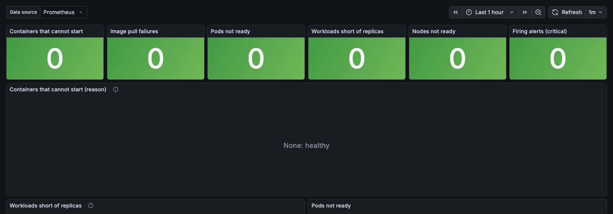
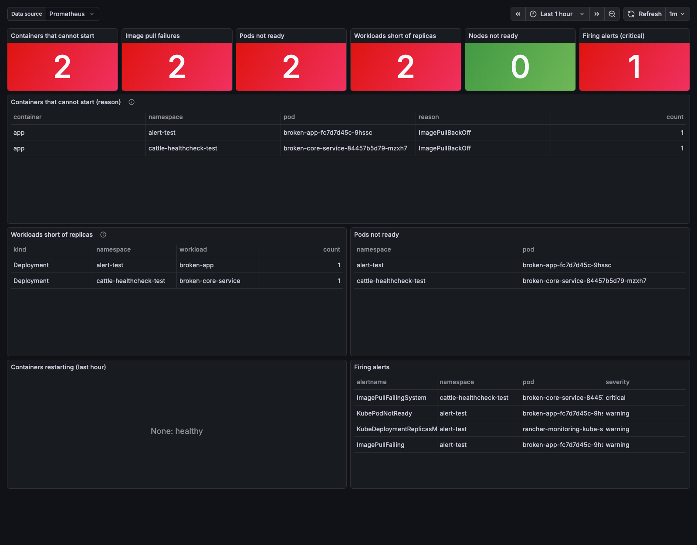

# Rancher cluster health: dashboard and image-pull alerts

A one-screen Grafana dashboard that is empty when the cluster is healthy, and
alerts that fire when a container cannot pull its image. Built for
**Rancher Monitoring** (the `rancher-monitoring` chart that Rancher installs from
Cluster Tools). Tested with chart `110.0.2+up80.9.1-rancher.22`.

## Why the stock alerts can miss this

Rancher Monitoring ships `KubeContainerWaiting` (fires after 1 hour) and
`KubePodNotReady` (15 minutes, warning). `KubeContainerWaiting` keeps the
waiting `reason` as a label. A pod that cannot pull its image alternates between
`ErrImagePull` and `ImagePullBackOff` on every retry (at most every 5 minutes), so
each flip starts a new alert whose 1-hour timer begins again. In testing its timer
restarted every few minutes, so it never got near 1 hour and never fired. The
rules here group without the reason, so the timer survives the flips: the
5-minute rule fired on time while the stock rule was still restarting.

Even a firing alert does nothing unless Alertmanager routes it somewhere. Step 3
covers that, including a Rancher default that silently drops most alerts.

## Files

| File | What it is |
|---|---|
| `01-prometheusrule.yaml` | `ImagePullFailingSystem` (critical after 5 minutes, system namespaces) and `ImagePullFailing` (warning after 15 minutes, everything else) |
| `02-dashboard-configmap.yaml` | The "Cluster Health" dashboard, loaded by Rancher's Grafana from `cattle-dashboards` |
| `cluster-health.json` | The same dashboard for **Dashboards, New, Import** in Grafana |
| `03-alertmanagerconfig-email.yaml` | Route the alerts to email |
| `03-alertmanagerconfig-teams.yaml` | Route the alerts to a Microsoft Teams channel |
| `test/` | A webhook receiver, a test route and two broken workloads to prove it end to end |

## 1. Check Rancher Monitoring is installed

Rancher UI: the cluster, **Cluster Tools**, **Monitoring**. If it is not installed,
install it there with the defaults. Then:

```sh
kubectl -n cattle-monitoring-system get pods            # prometheus, alertmanager, grafana Running
kubectl get ns cattle-dashboards                         # created by the chart
```

## 2. Add the alerts and the dashboard

Edit the system-namespace list in `01-prometheusrule.yaml` first if your core
services live elsewhere (the regex appears twice: `=~` in the first rule and `!~`
in the second; keep them identical).

```sh
kubectl apply -f 01-prometheusrule.yaml
kubectl apply -f 02-dashboard-configmap.yaml
```

Rancher Monitoring loads PrometheusRules from every namespace and Grafana loads any
ConfigMap labelled `grafana_dashboard: "1"` in `cattle-dashboards`, so nothing
else is needed. Open Grafana from the Rancher UI (**Monitoring**, **Grafana**),
then **Dashboards**, **Cluster Health**.

Healthy, every counter green and every table empty:



During the step 4 test (two broken workloads):



| Panel | Shows | Healthy |
|---|---|---|
| Six counters | containers that cannot start, image pull failures, pods not ready, workloads short of replicas, nodes not ready, firing critical alerts | all `0`, green |
| Containers that cannot start (reason) | namespace, pod, container and reason for every stuck container: ImagePullBackOff, CrashLoopBackOff, CreateContainerConfigError and so on | `None: healthy` |
| Workloads short of replicas | Deployments, DaemonSets and StatefulSets with unavailable replicas | `None: healthy` |
| Pods not ready | every pod not Ready (finished Job pods excluded) | `None: healthy` |
| Containers restarting (last hour) | restarts per container | `None: healthy` |
| Firing alerts | everything Alertmanager would send, except Watchdog | `None: healthy` |

To make it the first thing people see: open the dashboard, star it, then
**Administration**, **Default preferences**, **Home dashboard**: Cluster Health.

## 3. Send the alerts somewhere

Pick `03-alertmanagerconfig-email.yaml` or `03-alertmanagerconfig-teams.yaml`,
fill in the placeholders and the Secret, and apply it.

**The trap:** by default an AlertmanagerConfig only receives alerts whose
`namespace` label equals the AlertmanagerConfig's own namespace (the operator's
`OnNamespace` matcher strategy). A route created in `cattle-monitoring-system`
therefore never sees an alert about a pod in `kube-system`. Turn that off once,
in the Rancher Monitoring chart values (Rancher UI: **Apps**, **Installed Apps**,
`rancher-monitoring`, **Edit/Upgrade**, YAML):

```yaml
alertmanager:
  alertmanagerSpec:
    alertmanagerConfigMatcherStrategy:
      type: None
```

Check it took effect:

```sh
kubectl -n cattle-monitoring-system get alertmanager -o jsonpath='{.items[0].spec.alertmanagerConfigMatcherStrategy}'
# {"type":"None"}
```

## 4. Test it

Uses a namespace that matches the system pattern (`cattle-.*`), so nothing real is
touched. Allow about 7 minutes.

```sh
kubectl apply -f test/webhook-receiver.yaml          # namespace alert-test: logs what Alertmanager sends
kubectl apply -f test/alertmanagerconfig-webhook.yaml
kubectl apply -f test/broken-workloads.yaml          # two Deployments with an image tag that does not exist

kubectl get pods -A | grep broken                    # ErrImagePull / ImagePullBackOff
```

- At once: the dashboard counters show `2` and both pods appear in the tables.
- After about 5 minutes: `ImagePullFailingSystem` fires (Grafana **Alerting**, or
  the Alertmanager UI from the Rancher Monitoring page).
- Within a minute of firing: the receiver logs it:

  ```sh
  kubectl -n alert-test logs deploy/alert-sink
  # ALERT firing ImagePullFailingSystem critical cattle-healthcheck-test broken-core-service-...
  ```

- After 15 minutes: `ImagePullFailing` (warning) fires for the `alert-test` pod.

Clean up, which also shows the "resolved" message arriving:

```sh
kubectl delete -f test/broken-workloads.yaml
kubectl -n alert-test logs deploy/alert-sink | tail   # ALERT resolved ...
kubectl delete -f test/alertmanagerconfig-webhook.yaml -f test/webhook-receiver.yaml
```

## Test record

Run on a three-node k3s cluster with `rancher-monitoring` `110.0.2+up80.9.1-rancher.22`
installed from the Rancher chart repository with default values:

| Check | Result |
|---|---|
| Rule loaded from `cattle-monitoring-system` | yes, no extra selector needed |
| Dashboard loaded from `cattle-dashboards` | yes, within a minute |
| Dashboard with two broken workloads | every counter and table showed both (screenshot above) |
| `ImagePullFailingSystem` | pending at once, firing 5 minutes later, through the reason flips |
| Stock `KubeContainerWaiting` on the same pods | timer restarted at each flip, still pending when the test ended |
| Route in `cattle-monitoring-system`, default matcher strategy | alert sent to the `null` receiver; generated route carried `namespace="cattle-monitoring-system"` |
| Same route after `alertmanagerConfigMatcherStrategy: {type: None}` | firing message at the webhook within a minute |
| Workload deleted | resolved message within about a minute |
| `ImagePullFailing` (warning, other namespaces) | firing after 15 minutes, delivered |
| Email and Teams routes | accepted by the API server (`kubectl apply --dry-run=server`); not sent to a real mailbox or channel |

## Notes

- `for: 5m` and `for: 15m` are the only timing knobs. Alertmanager waits a further
  `groupWait` (30 seconds here) before the first message.
- `InvalidImageName` is included: it never retries, so it would otherwise only
  show on the dashboard.
- The dashboard needs nothing beyond kube-state-metrics, which Rancher Monitoring
  includes.
